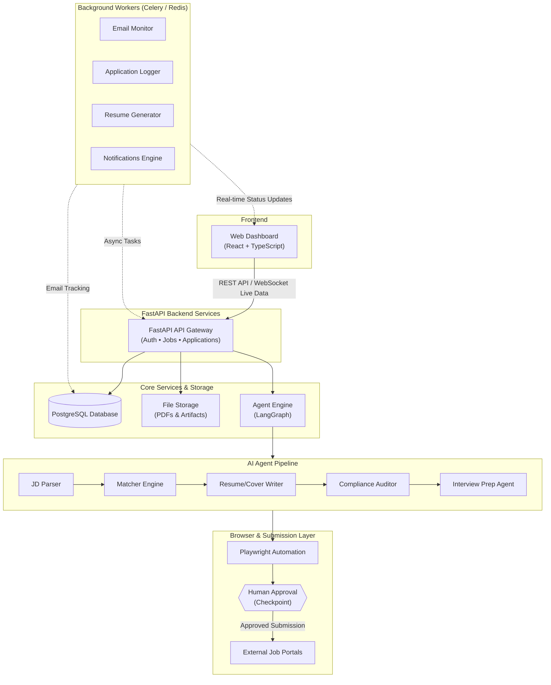

# Autonomous Job-Application Agent
---

## 1. System Architecture Diagram

The diagram below outlines the full-stack architecture, including the React dashboard, FastAPI backend services, LangGraph agent pipelines, database layer, Playwright automation module, and background workers.

---
