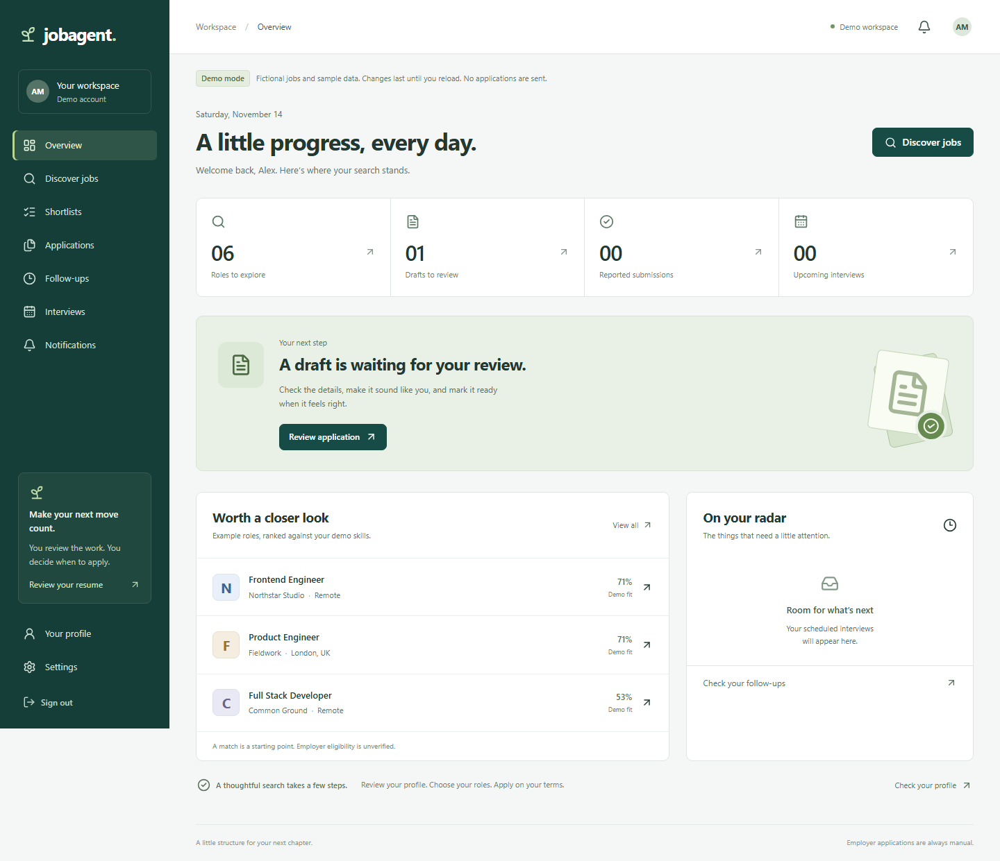
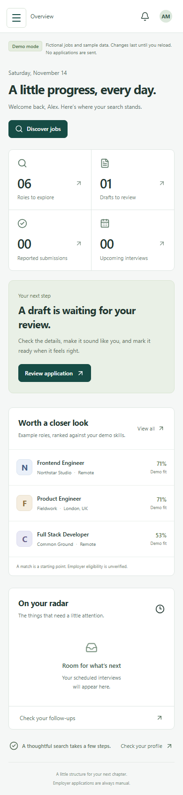

# Frontend implementation and handover

Implemented against the supplied Days 25–35 roadmap. This is a frontend delivery with a working sample journey. Backend security, persistence, hosting, and production release remain separate gates. No backend source, migration, dependency, environment file, or container configuration was changed. No branches or pull requests were created.

## Run locally

Use Node 24, matching the development environment and frontend CI. From the repository root:

```powershell
cd frontend
npm ci
npm run dev
```

Open the URL printed by Vite, normally `http://127.0.0.1:5173`. Choose **Explore the demo**. No account, backend, database, or API key is required for the sample workspace. To use the onboarding route, open `/onboarding` after entering the demo.

The optional demo uses fictional employers and sample profile data. Live job search reads backend records. Candidate onboarding and profile saves write through to the API after Supabase sign-in. Candidate IDs persist only in the current browser session. Use synthetic data until backend ownership and privacy controls are deployed.

## Architecture and design

The app uses React, Vite, strict TypeScript, React Router, Tailwind CSS, Radix Dialog, TanStack Query, React Hook Form, Zod, and Supabase Auth. Exact installed versions are pinned in `frontend/package.json` and `frontend/package-lock.json`.

The workspace has a dark teal navigation rail, a light gray-green content area, and restrained green status accents. Segoe UI uses the local system font without a third-party font request. The dashboard puts a draft review task ahead of less urgent activity. Job listings use a grid; application records use rows and a history timeline. Color tokens include forest `#164c45`, sidebar `#163e38`, ink `#233832`, canvas `#f5f7f6`, muted text `#61736d`, and border `#dee6e2`. Content is left aligned. On small screens, navigation moves into a dismissible drawer and columns stack.

`unslop` was applied to the interface copy and this handover: labels describe the action, errors explain the recovery, and claims stay within the implemented behavior. The supplied roadmap remains unchanged. In particular, **prepared**, **submitted by you**, and **confirmed by an employer** are different claims; this app never claims the third.

| Location | Responsibility |
| --- | --- |
| `frontend/src/app/router.tsx` | Public routes, protected workspace, demo-only private feature gate |
| `frontend/src/app/store.tsx` | In-memory demo state and reset |
| `frontend/src/features/auth/AuthProvider.tsx` | Optional Supabase session, logout, expiry, query-cache clearing |
| `frontend/src/components/layout/AppShell.tsx` | Sidebar, mobile navigation, topbar, demo disclosure |
| `frontend/src/components/ui/index.tsx` | Alerts, empty state, loading skeleton, badges, error boundary, accessible modal |
| `frontend/src/pages/` | Feature screens and forms |
| `frontend/src/lib/api.ts` | Public API allowlist, typed request helper, error redaction, file and URL validation |
| `frontend/src/lib/api-types.ts` | Generated FastAPI schema types |
| `frontend/src/lib/openapi.json` | Snapshot exported from this checkout |
| `frontend/src/lib/demo.ts` | Fictional fixtures, status rules, revision and handoff guards |
| `frontend/src/lib/calendar.ts` | Demo UTC calendar export, text escaping, UTF-8 line folding |
| `frontend/src/test/` and `frontend/src/lib/*.test.ts` | UI and business-boundary tests |
| `frontend/e2e/` | Chromium desktop and mobile browser journeys |
| `.github/workflows/frontend-ci.yml` | Frontend-only checks and browser QA |

## Routes and implemented behavior

All workspace routes require a verified Supabase session or an explicitly chosen sample session. Demo access never authorizes a private backend request.

| Route | Behavior |
| --- | --- |
| `/` | Product explanation, account links, entry to sample workspace |
| `/signup`, `/login` | Validated optional Supabase account forms with pending and failure messages |
| `/forgot-password`, `/auth/callback` | Recovery request, callback session feedback, password update |
| `/onboarding` | Profile setup followed by resume review |
| `/dashboard` | Sample role, draft, reported-submission, and interview counts; next task; example matches |
| `/profile` | Name, email, location, years, summary, unique skills, editable education and work history |
| `/resume` | File selection/drop validation, fixed-sample preview, editable sample skills, reviewed deduplicated import |
| `/jobs` | URL-backed keyword/company/location/work-mode/salary/currency filters, pagination, page-local title sorting |
| `/jobs/:jobId` | Source, description, salary, work mode, safe source link for real listings; illustrative demo explanation |
| `/workflows`, `/workflows/:workflowId` | Local shortlist generation, role selection, explicit approval/rejection, draft creation for approved roles |
| `/applications`, `/applications/:applicationId` | Status counts and search, editable letter, numbered revision history, preflight confirmations, prepared handoff, independent submission report, status timeline |
| `/follow-ups` | Overdue/upcoming/resolved groups, scheduling, complete/dismiss actions |
| `/interviews`, `/interviews/:interviewId` | List/date agenda, schedule/reschedule, overlap/version checks, cancel/complete confirmations, `.ics` download |
| `/notifications` | Due-reminder simulation, available/read items, future reminders kept separate |
| `/settings` | Session sign-out, confirmed demo reset, privacy and feature limitations |
| Unknown routes | Accessible recovery page with a home link |

The shared forms have visible labels, keyboard focus indicators, field errors, and feedback. Radix dialogs trap focus, close with Escape, and restore focus. The navigation drawer exposes its expanded state; a skip link reaches main content. Layouts support mobile widths and reduced motion. The app has loading, empty, error, success, and forbidden states where the corresponding operation exists.

## API audit and integration boundaries

The current `backend/app/main.py` includes the candidate router without an additional prefix. The effective candidate base path is `/api/v1/candidates`; the roadmap's duplicate-prefix warning does not apply to this checkout.

Candidate profile, skills, experience, education, resume preview, and resume import routes have no verified account ownership dependency. Several later feature routers depend on a shared development gate. Neither meets the roadmap's private-user authorization requirement. No `/me` or equivalent verified identity-to-candidate endpoint exists in the exported contract. The frontend therefore has no UUID entry box, no inferred candidate mapping, and no development-key input.

The frontend calls `GET /api/v1/jobs` and `GET /api/v1/jobs/{job_id}` for live listings, including supported filters and pagination. Candidate onboarding calls `POST /api/v1/candidates`, saves the returned candidate ID to `sessionStorage`, updates the profile with `PATCH /api/v1/candidates/{candidate_id}`, and creates skills through the existing skills route. The current backend does not bind that ID to the signed-in Supabase subject or verify ownership. This integration is for isolated local/QA use with synthetic data; a browser-stored candidate UUID is not authentication.

The API helper permits the public job routes and existing candidate/profile, skill, experience, education, and resume route patterns. It never adds `X-Dev-Job-Key`. Endpoints protected by that key remain unavailable from the browser until a verified user contract or trusted server-side proxy exists. Supabase login does not authorize FastAPI requests because the current app does not validate Supabase JWTs.

Live job query parameters match the exported API: `q`, `company`, `location`, `work_mode`, `employment_type`, `minimum_salary`, `salary_currency`, `limit`, and `offset`. Salary filters require a currency. Title sorting applies to the current page because the API does not expose server sorting. Public list and detail requests use TanStack Query with cancellation, a 15-second timeout, 30-second staleness, and no automatic retries. API errors are mapped to safe UI messages for 401, 403, 404, 409, 422, 429, and 503. Backend response bodies and stack traces are not shown.

### Refresh generated types

From the repository root, with the existing backend environment installed:

```powershell
.venv/Scripts/python.exe -B frontend/scripts/export_openapi.py
cd frontend
npm run api:types
npm run typecheck
```

The exporter sets an in-memory SQLite URL, disables AI use, prevents Python bytecode writes, imports the app, and calls `app.openapi()`. It does not query the database or call an API. It does not modify backend files. The schema includes development operations for contract completeness; those operations are not exposed in the UI.

### Remaining private integration

Workflow, application, handoff, follow-up, interview, and notification endpoints remain blocked because their routers require the server-side development key. Do not place that key in Vite variables or browser requests. To enable the rest of the live journey, the backend must validate Supabase JWTs, map the verified subject to a candidate, enforce ownership on every record and file, and pass two-account isolation tests. The later feature routers also need a production auth dependency to replace the development gate. Once available, implement adapters from the generated API types and preserve server revision/version numbers, resume snapshots, preflight checks, and handoff results.

The API now sends an explicit CORS allowlist (`FRONTEND_URL` plus the localhost/127.0.0.1 ports 3000 and 5173) and permits the `Authorization` header, so browser requests from the Vite dev server reach the backend. Other remaining blockers are possible in-memory workflow loss on restart, notification visibility depending on the worker, and unresolved migration/release gates. The current frontend exposes the real API calls it can make, reports errors for unavailable operations, and keeps the demo as an optional isolated walkthrough. It does not claim that the remaining live application flow is complete.

The client cannot fix ownership, migration drift, workflow persistence, or worker scheduling. It does not claim to have verified those systems.

## Configuration and privacy

Copy `frontend/.env.example` to `frontend/.env.local` only when configuring a QA environment:

| Variable | Purpose |
| --- | --- |
| `VITE_API_BASE_URL` | API origin; defaults to `http://127.0.0.1:8000` |
| `VITE_SUPABASE_URL` | Supabase Auth project URL |
| `VITE_SUPABASE_PUBLISHABLE_KEY` | Browser-safe Supabase publishable/anon key |

Only these browser-safe values belong in Vite configuration. Database URLs, provider credentials, service-role keys, JWT verification secrets, and backend development credentials must stay out of the browser. The app does not read the repository's root `.env`.

### Supabase signup and login setup

Signup, password login, password recovery, and callback handling use `@supabase/supabase-js` directly. The API wrapper forwards the current access token as a bearer token when a Supabase session exists. Supabase Auth does not require additional FastAPI routes for the form actions, so no backend auth files are needed to connect the forms. Forwarding the token does not authenticate the current FastAPI data endpoints: the backend still needs JWT validation and candidate ownership before user data is safe.

1. Create or select a Supabase project and enable email/password under Authentication providers.
2. Copy the project URL and the browser-safe publishable key from the Supabase project API settings into `frontend/.env.local`:

   ```dotenv
   VITE_API_BASE_URL=http://127.0.0.1:8000
   VITE_SUPABASE_URL=https://YOUR_PROJECT.supabase.co
   VITE_SUPABASE_PUBLISHABLE_KEY=YOUR_PUBLISHABLE_KEY
   ```

3. In Supabase Authentication URL configuration, set the local Site URL to `http://127.0.0.1:5173` and add `http://127.0.0.1:5173/auth/callback` to allowed redirects. Add the matching HTTPS staging/production origins only when those hosts exist.
4. Restart Vite after changing `.env.local`. The app uses PKCE, processes the verification/recovery callback at `/auth/callback`, persists the Supabase session in browser storage, refreshes expiring tokens, and clears private query data on logout or account changes.
5. Create a test account, follow its email verification link, sign in, and confirm that protected navigation opens. Test recovery with a separate QA account. Email delivery depends on the project's configured email provider and limits.

The browser uses only the project URL and publishable key. Never place a Supabase secret/service-role key in a `VITE_*` variable. The forms show a configuration message when these values are absent. The actual hosted project, email delivery, and callback allowlist are external configuration and were not changed here. Existing authenticated UI tests mock Supabase and do not exercise a real project.

Resume selection checks extension, MIME when supplied, empty content, and the backend's 5 MiB size limit. The current resume screen still uses a fixed sample review and does not send the selected file. Live parsing and import need a complete consent and secure ownership flow. Account export/deletion and server retention policies remain unavailable.

## State and action rules

The demo follows the backend status graph: draft → ready → submitted → interview → offered, with rejected/withdrawn transitions where supported. Offered, rejected, and withdrawn are terminal. Review confirmation is mandatory before ready. A separate checkbox records the user's external submission report. Preparing a handoff keeps the application ready, and repeating preparation for the same revision changes no status or history. Editing a draft increments its revision, preserves its previous text, and invalidates a prepared handoff. Stale revisions are rejected with reload guidance. Each draft keeps a profile snapshot from creation, so later profile edits do not change its evidence.

Shortlist approval creates no application automatically. A user creates each draft separately, and an existing application prevents duplicate drafts for the same sample job. The demo score is explicitly a keyword formula, not an AI confidence score or the backend ranking. It does not verify employer eligibility or predict interviews.

Follow-ups and interviews are scheduled only for reported submissions/interviews. Terminal application states close pending demo follow-ups and scheduled interviews. Times entered in the browser's timezone are stored as UTC; calendar exports use UTC, escaped text, CRLF endings, and 75-octet line folding. Overlapping scheduled interviews and stale versions are rejected. Date agenda is a chronological alternative to the list, not a month-grid calendar.

Due reminder processing in the demo is an explicit simulation. Only active interview/version reminders due before the interview starts enter the inbox; future reminders remain separate. Read state is local. Rescheduling or cancelling removes outdated reminders from the visible inbox. No email, push notification, or employer request is made.

## Roadmap coverage and release status

| Milestone | Frontend delivery | Remaining dependency or limit |
| --- | --- | --- |
| 25 | App shell, navigation, primitives, OpenAPI snapshot/types, test tooling | Backend contract drift must be re-exported when routes change |
| 26 | Supabase client/forms, callback/recovery, session guard, expiry, cache clearing | Live QA Auth and server JWT/ownership checks unverified; private screens blocked |
| 27 | Onboarding/profile editors, file validation, explicit sample review/import | Real parsing, contact/history extraction and import require protected private APIs |
| 28 | Search/filter/detail UI, public jobs adapter, sample explanations | Personal ranking/explanation endpoints blocked; real API not smoke-tested |
| 29 | Sample shortlist approval, draft revisions, handoff confirmations | Server workflow durability, full preflight response and real handoff blocked |
| 30 | Application list/history/status, manual submission report, follow-ups | Live persistence and history integration blocked |
| 31 | Interview scheduling, date agenda, UTC export, inbox/read UI | Real notification processing and worker schedule unverified |
| 32 | Failure messages, cache clearing, session expiry, private-call allowlist | Migration remediation, durable checkpoints and authorization are backend work |
| 33 | Unit/UI tests, desktop/mobile sample browser QA, frontend CI definition | Real browser-to-private-API isolation and restart tests not run |
| 34 | Static artifact build, SPA fallback/header examples, deployment instructions | No host selected or deployed; HTTPS/CORS/callbacks require staging QA |
| 35 | User walkthrough, limitations, handover and gate record | No production approval, release tag, external UAT signoff or public launch |

**Release decision: local/isolated QA integration only.** Public job reads and candidate/profile writes now call existing FastAPI endpoints. Candidate data is not safe for public deployment because ownership checks are absent. Development-key routes, the live workflow lifecycle, real resume preview/import, hosting, and backend release gates remain blocked or unverified. No backend files were changed.

## Validation

Run from `frontend/`:

```powershell
npm run lint
npm run format:check
npm run typecheck
npm run test -- --maxWorkers=1
npm run build
npx playwright install chromium
npm run test:e2e -- --workers=1
```

Vitest covers confirmation boundaries, version conflicts, terminal states, URL/file validation, safe HTTP errors, private request blocking, calendar escaping/folding, account form errors, profile validation, missing routes, and signed-out guards. Browser scenarios cover sample shortlist → draft edit → review → manual handoff → user-reported submission → follow-up → interview → calendar download → scheduled reminders, plus profile correction, resume validation/import, URL filters, empty results and logout. They run in Chromium at desktop and mobile sizes, with no real employer submissions. External service signup and authenticated two-user integration are intentionally outside this local suite.

Frontend CI runs install, lint, typecheck, generated-type drift check, Vitest, build, and browser QA. Failure-only traces/screenshots are retained for seven days. The existing backend workflows are unchanged. Local result counts and visual review evidence are recorded below after verification.

## Staging deployment and rollback

1. Build with `npm ci` and `npm run build` using QA-only public configuration. `npm run preview` serves a local artifact; it is not a production server.
2. Upload `frontend/dist` to an access-controlled static host. Keep a versioned copy of the last verified artifact for rollback. No provider selection or deployment was performed.
3. Configure the host to serve `index.html` for app routes while preserving asset 404s. The `_redirects` example uses the common static-host syntax; verify support with the selected provider.
4. Apply security headers. `_headers` is a static-host example with a broad HTTPS connection rule so that the QA Supabase origin works; narrow `connect-src` to the exact API/Auth origins and add `wss:` only if required. Configure headers explicitly if the host does not read this file.
5. Set Supabase site/callback URLs to the actual HTTPS staging origin. Have the backend owner allowlist that origin in CORS. Do not weaken browser security to bypass CORS.
6. Test root and nested-route reloads, callback/recovery, mobile navigation, logout/expiry, API outage, and the absence of secrets in built assets. Private features must remain blocked until authorization QA passes.
7. To roll back, restore the previous verified static artifact and its matching public configuration. Recheck landing, nested routes and callbacks. Do not change or roll back database migrations as part of a frontend rollback.

## Candidate walkthrough

Enter the demo from the landing page. Open your profile to correct the sample details, then review the resume sample if useful. Discover jobs and inspect a role's source and match evidence. Create a shortlist, select a role, and confirm approval. Create its draft, edit the letter, and save a revision. Mark it ready only after reviewing the materials. Prepare a manual handoff and read the disclosure. In actual use you would open the employer site and apply yourself; fictional demo roles do not have a real destination. Record a submission only after that external action. Schedule follow-ups and interviews, export a calendar event, and check available reminders in Notifications. Settings can reset the demo, and sign-out clears this visit.

## Local verification evidence

Verified on November 14, 2026:

| Check | Result |
| --- | --- |
| TypeScript | Passed |
| ESLint | Passed with zero warnings |
| Vitest | 35 tests passed across four files |
| Playwright | Four scenarios passed across desktop Chromium and a 390px mobile viewport |
| Production build | Passed; feature pages are loaded in separate chunks |
| Backend diff | Empty; no backend files changed |
| Built-asset credential-name scan | No matches for backend development, database, Groq, or service-role credential names |
| Unslop phrase/structure scans | No phrase violations or documentation structure flags; soft silhouette findings reviewed as advisory for this technical reference |

Mocked Auth tests exercise verified and unverified users, account switching, cache clearing, token expiry, and sign-out events. They do not prove server JWT verification or cross-user database isolation. Browser scenarios check that the sample journey makes no request to the fictional employer destination.

Desktop and mobile screenshots were opened for visual review. Text, cards, and navigation fit both viewports without horizontal overflow. These screenshots use the sample workspace. To capture fresh images while the dev server runs on port 5174, run `node scripts/capture.mjs` from `frontend/`.





## Exported endpoint inventory

The inventory below is generated from this checkout's schema. Presence in this table does not mean that an operation is enabled in the frontend.

| Method | Path |
| --- | --- |
| POST | /api/v1/candidates |
| GET | /api/v1/candidates/{candidate_id} |
| PATCH | /api/v1/candidates/{candidate_id} |
| POST | /api/v1/candidates/{candidate_id}/skills |
| GET | /api/v1/candidates/{candidate_id}/skills |
| PATCH | /api/v1/candidates/{candidate_id}/skills/{skill_id} |
| DELETE | /api/v1/candidates/{candidate_id}/skills/{skill_id} |
| POST | /api/v1/candidates/{candidate_id}/experiences |
| GET | /api/v1/candidates/{candidate_id}/experiences |
| PATCH | /api/v1/candidates/{candidate_id}/experiences/{experience_id} |
| DELETE | /api/v1/candidates/{candidate_id}/experiences/{experience_id} |
| POST | /api/v1/candidates/{candidate_id}/education |
| GET | /api/v1/candidates/{candidate_id}/education |
| PATCH | /api/v1/candidates/{candidate_id}/education/{education_id} |
| DELETE | /api/v1/candidates/{candidate_id}/education/{education_id} |
| POST | /api/v1/candidates/{candidate_id}/resume/preview |
| POST | /api/v1/candidates/{candidate_id}/resume/import |
| GET | /api/v1/jobs |
| POST | /api/v1/jobs |
| GET | /api/v1/jobs/{job_id} |
| GET | /api/v1/candidates/{candidate_id}/matches |
| GET | /api/v1/candidates/{candidate_id}/hybrid-matches |
| GET | /api/v1/candidates/{candidate_id}/recommendations |
| GET | /api/v1/candidates/{candidate_id}/recommendations/{job_id}/explanation |
| POST | /api/v1/candidates/{candidate_id}/workflows |
| GET | /api/v1/candidates/{candidate_id}/workflows/{workflow_id} |
| POST | /api/v1/candidates/{candidate_id}/workflows/{workflow_id}/review |
| POST | /api/v1/candidates/{candidate_id}/workflows/{workflow_id}/application-drafts/{job_id} |
| POST | /api/v1/candidates/{candidate_id}/workflows/{workflow_id}/tracked-applications/{job_id} |
| GET | /api/v1/candidates/{candidate_id}/applications |
| GET | /api/v1/candidates/{candidate_id}/applications/{application_id} |
| PATCH | /api/v1/candidates/{candidate_id}/applications/{application_id}/draft |
| POST | /api/v1/candidates/{candidate_id}/applications/{application_id}/status |
| GET | /api/v1/candidates/{candidate_id}/applications/{application_id}/submission-preflight |
| POST | /api/v1/candidates/{candidate_id}/applications/{application_id}/manual-handoff |
| GET | /api/v1/candidates/{candidate_id}/applications/{application_id}/manual-handoff |
| POST | /api/v1/candidates/{candidate_id}/applications/{application_id}/follow-ups |
| GET | /api/v1/candidates/{candidate_id}/applications/{application_id}/follow-ups |
| GET | /api/v1/candidates/{candidate_id}/follow-ups |
| POST | /api/v1/candidates/{candidate_id}/applications/{application_id}/follow-ups/{follow_up_id}/resolve |
| GET | /api/v1/candidates/{candidate_id}/application-monitoring |
| POST | /api/v1/candidates/{candidate_id}/applications/{application_id}/interviews |
| GET | /api/v1/candidates/{candidate_id}/interviews |
| GET | /api/v1/candidates/{candidate_id}/interviews/{interview_id} |
| PATCH | /api/v1/candidates/{candidate_id}/interviews/{interview_id} |
| POST | /api/v1/candidates/{candidate_id}/interviews/{interview_id}/action |
| GET | /api/v1/candidates/{candidate_id}/interviews/{interview_id}/calendar.ics |
| POST | /api/v1/candidates/{candidate_id}/interview-notifications/refresh |
| GET | /api/v1/candidates/{candidate_id}/interview-notifications |
| POST | /api/v1/candidates/{candidate_id}/interview-notifications/{notification_id}/read |
| GET | /api/v1/ops/readiness |
| GET | /api/v1/candidates/{candidate_id}/notification-recovery/preview |
| POST | /api/v1/candidates/{candidate_id}/notification-recovery/apply |
| GET | /api/v1/candidates/{candidate_id}/notification-recovery/runs |
| GET | /api/v1/ops/deployment |
| GET | /api/v1/ops/migration-audit |
| GET | /api/v1/ops/release-readiness |
| GET | /health |
| GET | /health/db |
